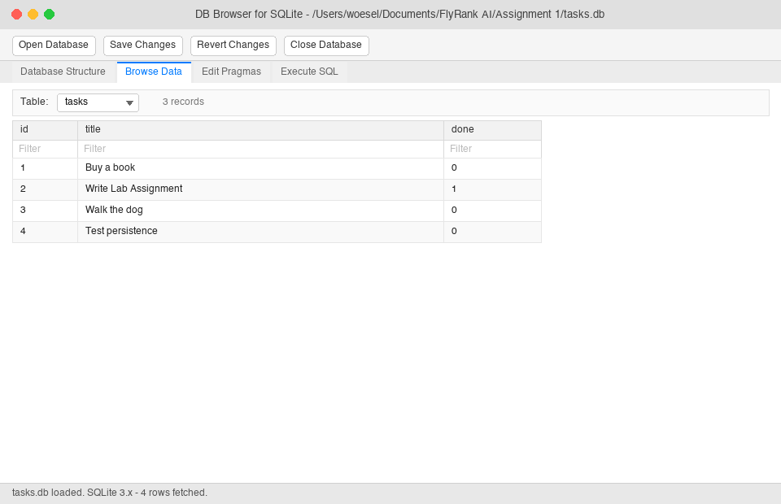
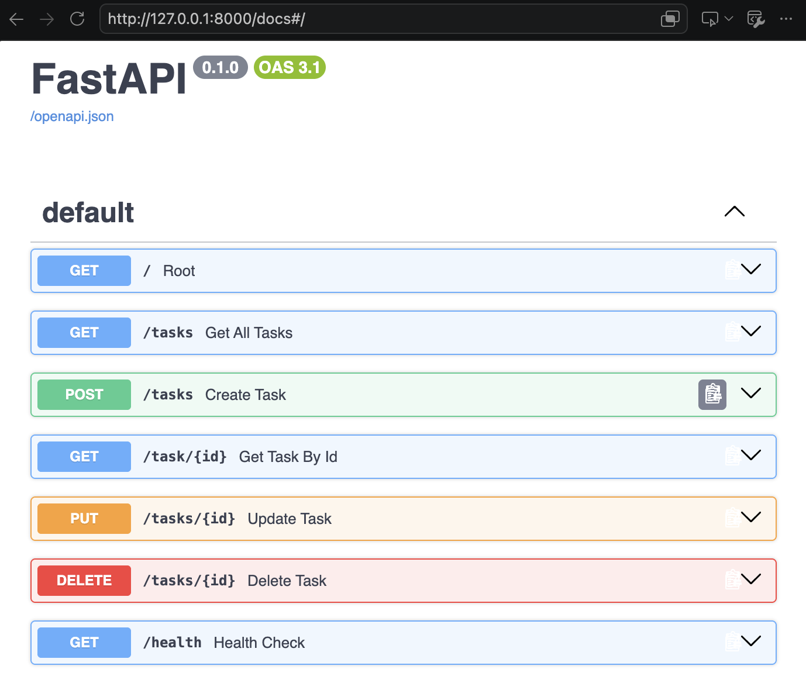

# Task API

A CRUD Task API built with FastAPI and SQLite.

## What this is
A database-backed CRUD API where tasks are stored persistently in a local SQLite database (`tasks.db`) instead of in-memory lists.

## Why SQLite?
- **Single file:** The entire database lives in a single local file (`tasks.db`), making it portable and easy to inspect.
- **Zero setup:** SQLite is serverless and built directly into Python's standard library (`sqlite3`). There is no external database server, background service, or credentials to configure.
- **Survives restarts:** Data is written to disk, so all tasks persist across server restarts.

## Where the database lives
- The database is stored in `tasks.db` at the project root.
- It is created automatically on first run, and pre-seeded with 3 initial example tasks if empty.
- `tasks.db` is added to `.gitignore` so every new clone starts fresh and initializes cleanly.

## Quick install & run (single command)
Run this from the project root:

```bash
python3 -m pip install -r requirements.txt && uvicorn hello:app --reload --host 127.0.0.1 --port 8000
```

Open the Swagger UI documentation at `http://127.0.0.1:8000/docs` to interact with the endpoints.

## Database Screenshot
Database view open in DB Browser for SQLite showing the `tasks` table and rows:



*(Swagger UI screenshot: `swagger.png`)*


## Endpoints
- GET `/` — API info and endpoints list
- GET `/tasks` — list all tasks (supports query params `?search=query` and `?done=true|false`)
- GET `/tasks/{id}` — get single task by ID
- POST `/tasks` — create task, body: `{"title": "Buy milk"}` → returns created task (201)
- PUT `/tasks/{id}` — update title and/or done status, body: `{"title": "Updated", "done": true}` → returns updated task (200)
- DELETE `/tasks/{id}` — delete task by ID (204 No Content)
- GET `/health` — health check

## Stage 4: Explored SQLite
Example SQL query executed directly on `tasks.db`:

```sql
SELECT * FROM tasks WHERE done = 1;
```

**Result:** Returned row `(2, "Write Lab Assignment", 1)`, filtering only completed tasks where `done = 1`. Updating the database directly shows changes immediately across API endpoints without needing a server restart.

## Optional Extras Implemented

### 1. Search with SQL (`LIKE`)
- `GET /tasks?search=book` filters matching task titles directly in the database using SQL's `LIKE` operator (`WHERE title LIKE ?`), avoiding filtering in Python loops.

### 2. Filter by Status
- `GET /tasks?done=true` and `GET /tasks?done=false` filter tasks in SQLite using a parameterized `WHERE done = ?` clause. Both search and status filters can also be combined.

### 3. Timestamps (`created_at` and `updated_at`)
- Each task record stores `created_at` and `updated_at` timestamps in ISO format.
- `created_at` is set when the task is inserted and remains constant.
- `updated_at` is updated whenever `PUT /tasks/{id}` modifies a task.

> **Changing the table's shape:**
> Adding `created_at` and `updated_at` columns after data already existed made it clear how tricky schema changes can be without automated tooling. We had to check for missing columns and backfill existing rows to avoid breaking existing queries, which immediately shows why migration systems are needed as applications grow.
